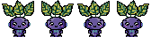
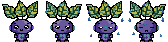
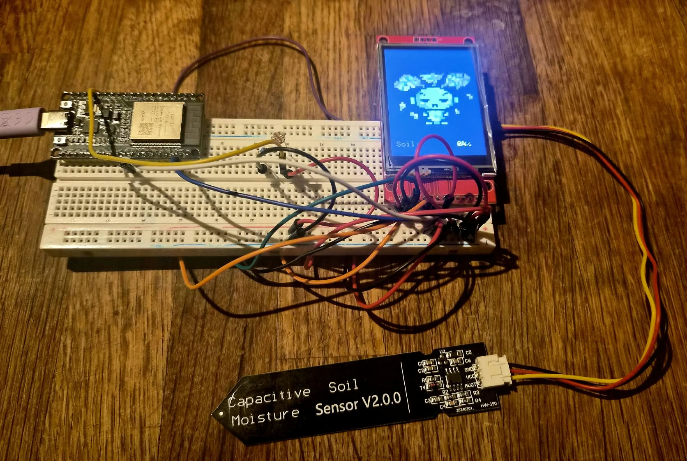

# Pet Plant

**An interactive virtual plant powered by an ESP32.**

Pet Plant is an embedded systems project that turns real-world sensor readings into the emotions and animations of a digital plant. An ESP32 measures soil moisture and ambient light, while a 2.4-inch TFT display shows a hand-drawn pixel-art companion.

> **Project status:** Working breadboard prototype. The permanent, soldered build is planned for a later stage.

## Features

- **Soil moisture monitoring** using a capacitive analog sensor.
- **Ambient light monitoring** using an LDR (photoresistor).
- **Three plant moods:** Thirsty, Healthy, and Too Wet.
- **Hand-drawn pixel-art sprites**, created in [Piskel](https://www.piskelapp.com/).
- **Non-blocking animations** driven by `millis()`.
- **Portrait TFT interface** (240 × 320 pixels) with a live soil moisture percentage.

## Hardware

| Component | Description |
| --- | --- |
| ESP32-WROOM-32 DevKit | Main microcontroller (38-pin development board) |
| ILI9341 TFT display | 2.4-inch, 240 × 320, SPI interface |
| Capacitive soil moisture sensor v1.2 | Analog soil moisture measurement |
| LDR (photoresistor) | Ambient light measurement |
| 10 kΩ resistor | Forms a voltage divider with the LDR |
| Breadboard and jumper wires | Temporary prototype assembly |

### 🔌 Circuit diagram and pin mapping

The circuit was designed in **Cirkit Designer** and assembled on a breadboard for testing. The connections below match the GPIO assignments used in the code.

<table>
  <tr>
    <td width="55%" valign="top">
      
    </td>
    <td width="45%" valign="top">
      <strong>ESP32 wiring</strong>
      <table>
        <tr><th>ESP32 pin</th><th>Connection</th></tr>
        <tr><td>3V3</td><td>TFT VCC, soil sensor VCC, LDR divider</td></tr>
        <tr><td>GND</td><td>TFT GND, soil sensor GND, 10 kΩ resistor</td></tr>
        <tr><td>GPIO 14</td><td>TFT CS</td></tr>
        <tr><td>GPIO 27</td><td>TFT DC</td></tr>
        <tr><td>GPIO 26</td><td>TFT RESET</td></tr>
        <tr><td>GPIO 18</td><td>TFT SCK</td></tr>
        <tr><td>GPIO 23</td><td>TFT SDI / MOSI</td></tr>
        <tr><td>GPIO 34</td><td>Soil sensor AOUT</td></tr>
        <tr><td>GPIO 35</td><td>LDR voltage-divider output</td></tr>
      </table>
    </td>
  </tr>
</table>

**LDR voltage divider:** `3V3 → LDR → GPIO 35 → 10 kΩ resistor → GND`. The LDR and resistor meet at the GPIO 35 measurement point.

**Notes:** The TFT's SDO/MISO and touchscreen pins are not used in the current implementation. The TFT backlight/LED pin must be wired according to the exact display module's specifications; do not assume it can be connected directly to 3.3 V. All modules share a common ground, and ESP32 GPIO inputs must never be exposed to 5 V.

## Hand-drawn pixel art

All plant sprites were **drawn by hand in Piskel**. Each animation consists of four unique **42 × 42 px frames**, exported as a **168 × 42 px spritesheet**. For the ESP32, the frames are converted into RGB565 arrays and rendered at **5× scale** (210 × 210 px) to keep the pixel-art look sharp.


<p align="center">
  
  <br>
<br>
  <strong>Thirsty — The plant needs water</strong>
</p>

<p align="center">
  
  <br>
    <br>
  <strong>Healthy — The plant is happy and healthy</strong>
</p>

<p align="center">
  
  <br>
    <br>
  <strong>Too Wet — The plant has received too much water</strong>
</p>


### Animation behavior

The animation system uses three phases:

- **Entering:** frames `1 → 2 → 3 → 4 → 3`.
- **Idle:** frames `3 ↔ 4` loop while the plant remains in the same state.
- **Exiting:** the animation returns to frame `1` before the next state begins.

The `millis()` timer allows animations and sensor measurements to update independently without blocking the main loop.

## How it works

The ESP32 reads the sensors, converts the soil sensor's analog output into a provisional moisture percentage, and selects the appropriate plant animation:

| Soil moisture* | Plant state |
| --- | --- |
| Below 35% | **Thirsty** |
| 35% to 65% | **Healthy** |
| Above 65% | **Too Wet** |

\*The current soil calibration uses `SOIL_DRY = 3300` and `SOIL_WET = 1300` as **temporary reference values**. The displayed percentage is a relative, calibrated estimate, not a laboratory measurement. These values and the mood thresholds will need adjustment for the final plant and soil.

The LDR is already available for light readings. A **sleep/wake mode based on ambient light** is a planned improvement.

## Breadboard prototype



The current setup is assembled on a breadboard so that connections, sensors, and animations can be tested and changed easily **before soldering**.

### Next hardware milestone

Once the circuit and software are stable, I plan to build a **permanent physical prototype** with soldered connections, cleaner wiring, and a more compact enclosure that holds the screen and electronics next to the real plant.

## Software and libraries

- C++ with the **Arduino framework**
- **ESP32 by Espressif Systems** board package
- `SPI.h`
- `Adafruit_GFX.h`
- `Adafruit_ILI9341.h`

### Project structure

```text
PetPlant/
├── PetPlant.ino           # Main setup and loop
├── Display.ino            # TFT initialization and drawing
├── Sensors.ino            # Sensor readings and calibration
├── Animation.ino          # Plant states and animation engine
├── too_wet_sprites.h      # RGB565 Too Wet frames
├── healthy_sprites.h      # RGB565 Healthy frames
├── thirsty_sprites.h      # RGB565 Thirsty frames
├── images/
│   ├── circuit_image.jpg  # Cirkit Designer diagram
│   ├── breadboard.jpg     # Breadboard prototype photo
│   ├── thirsty.png
│   ├── healthy.png
│   └── too_wet.png
└── README.md
```

## Roadmap

- [x] ESP32 and TFT communication
- [x] Soil moisture sensor readings
- [x] Light sensor input
- [x] Hand-drawn sprites for three moisture states
- [x] State-based animations and idle movement
- [x] Breadboard prototype
- [ ] Calibrate sensors with the final plant and soil
- [ ] Add sleep/wake animations based on ambient light
- [ ] Improve the TFT interface and sensor indicators
- [ ] Build and solder the permanent prototype
- [ ] Add a case or enclosure
- [ ] Explore automatic watering (pump, relay, and separate suitable power supply)
- [ ] Explore Wi-Fi monitoring and sensor history

## What I learned

This project has helped me practice **embedded C++**, analog sensor readings, SPI communication, TFT graphics, timing with `millis()`, pixel-art asset conversion, modular code organization, and hardware prototyping.

## 💚 Why I built Pet Plant

I wanted to combine electronics and creative programming in a project that feels alive. Pet Plant turns environmental measurements into a small animated companion while giving me a practical way to learn how sensors, microcontrollers, and graphics work together.

